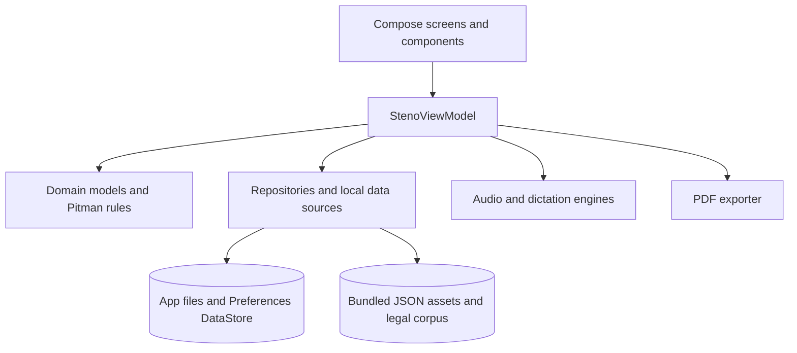

# Pitman Steno — Application Architecture

## 1. Current architecture

Pitman Steno is an offline-first Android application built with Kotlin, Jetpack Compose, Material 3, Navigation Compose, Coroutines/Flow, and Preferences DataStore. The repository currently ships as one Android application module (`:app`); the package boundaries below are the architecture boundaries. This document does not imply that separate Gradle modules already exist.

## 2. Package ownership

| Package | Responsibility | Must not own |
|---|---|---|
| `ui/screens` | Route-level Compose screens and screen composition | File I/O, audio lifecycle, JSON parsing |
| `ui/components` | Reusable Compose widgets, visual stroke canvas, lexicon panes | Persistence or navigation decisions |
| `ui/viewmodel` | UI state, user actions, orchestration, lifecycle-scoped jobs | Composable rendering or low-level file formats |
| `domain/model` | App entities, enums, analysis and UI-independent value types | Android framework APIs |
| `domain/pitman` | Pitman symbol catalogue, outline analysis and theory rules | Compose, Android Context, persistence |
| `data` | Legal corpus, RSS access, preferences and JSON lexicon persistence | UI rendering |
| `audio` | TTS, court audio playback and cadence engine lifecycle | Screen navigation |
| `export` | PDF generation from app data | UI state ownership |

## 3. Runtime data flow

1. A Compose screen renders the immutable `StenoUiState` exposed by `StenoViewModel.uiState`.
2. User events call ViewModel methods; screens do not mutate repositories directly.
3. The ViewModel coordinates domain analysis, repositories and lifecycle-scoped audio engines.
4. Repositories perform disk/network work off the main thread and return domain models or Flow state.
5. The ViewModel publishes updated state; Compose redraws from that state.

The ViewModel is the single presentation-state owner. Keep UI-only transient state inside the relevant composable; keep cross-screen or persisted state in the ViewModel/repository.

## 4. Persistence and offline behavior

- **Preferences:** `SettingsPreferences` uses Preferences DataStore for WPM, playback settings, theme, bookmarks and practice totals.
- **Pitman JSON lexicon:** `PitmanJsonLexiconRepository` seeds an app-private JSON database from `assets/pitman_legal_lexicon.json`, reads and writes it on `Dispatchers.IO`, and writes through a temporary file before replacing the database.
- **Static learning material:** the Pitman symbol catalogue and Pakistan legal corpus are bundled with the app.
- **External feed:** Dawn RSS content is fetched through the data layer; the app must continue to work when that feed is unavailable.

No account or remote database is required for the current offline learning workflow. User-created lexicon entries and preferences remain local to the device.

## 5. Feature boundaries

- **Dictation studio:** passage selection, TTS/court-audio modes, WPM/cadence controls, highlighting and bookmarks.
- **Symbols workbook:** consonant strokes, groups, recognition drills and symbol inspection.
- **Legal JSON DB:** local searchable lexicon, custom entry creation/deletion and reset-to-seed.
- **Draft studio:** custom text and legal templates.
- **Corpus:** bundled legal passages and optional editorial feed.
- **Export:** PDF output from the current practice/dictation content.

## 6. Dependency rules

- UI may depend on ViewModel state and domain models.
- ViewModel may coordinate domain, data, audio and export services.
- Domain must remain independent of Android, Compose and data packages.
- Data may depend on domain models, Android storage APIs and serialization libraries.
- Audio and export services must not depend on Compose screens.
- Do not introduce a second source of truth for state already represented in `StenoUiState`.

## 7. Quality gates

Before merging a feature:

1. Add or update domain tests for Pitman rules and deterministic transformations.
2. Add repository tests for JSON parsing, lookup ordering, seed/reset and persistence behavior.
3. Add ViewModel tests for state transitions and error handling.
4. Keep Compose UI tests focused on essential navigation and user-visible flows; avoid relying on scroll gestures when a visible control can be clicked directly.
5. Run `./gradlew testDebugUnitTest assembleDebug`.
6. Confirm the generated debug APK is uploaded as a CI artifact. A debug APK is for testing and is not a Play Store release.

## 8. Next architecture hardening

These are follow-up improvements, not claims about code already present:

- Introduce repository interfaces in the domain layer and keep Android implementations in `data`.
- Extract focused use cases for lexicon search/add/delete/reset and Pitman analysis once behavior is covered by tests.
- Replace positional `combine(...)` value casts in the ViewModel with smaller typed state flows as state grows.
- Add explicit loading/error state for lexicon initialization and RSS refresh.
- Add migration tests before changing the JSON schema or DataStore keys.
- Consider separate Gradle modules only when build size, team ownership or dependency isolation justifies the extra build complexity.

## 9. Current release boundary

The current project is a single-module Android app with a working debug-build pipeline. CI must pass unit/UI tests as well as compile and package the debug APK. A successful debug build alone does not establish release signing, Play policy readiness, privacy disclosures or production backend readiness.
